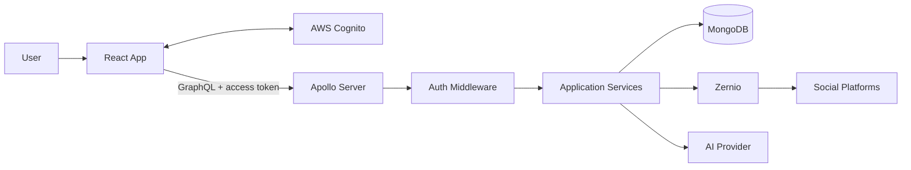
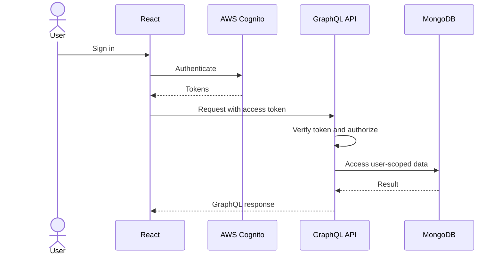
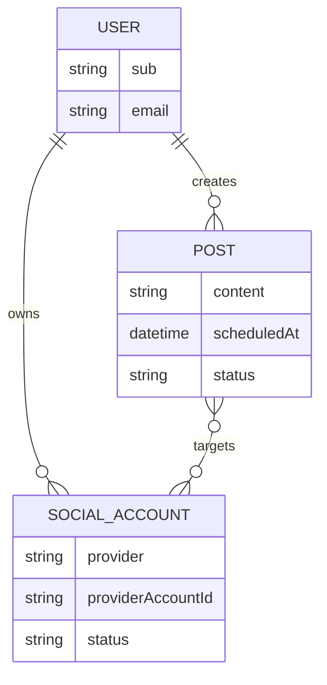

<div align="center">

# Social Media Management Platform

**Create, organize, and schedule social content from one workspace.**


Built with React, TypeScript, Tailwind CSS, Node.js, GraphQL, MongoDB, AWS Cognito, and Zernio.

</div>

---

## ✨ Overview

A centralized workspace for managing connected social accounts, drafting content with AI assistance, previewing posts, and planning publishing schedules.

## 🚀 Features

- **Authentication** — Sign up, email verification, login, and protected routes.
- **Social accounts** — Connect supported platforms through Zernio.
- **Content composer** — Draft, edit, and preview posts.
- **AI-assisted writing** — Generate or improve post copy.
- **Scheduling calendar** — Plan posts and track publishing status.

## 🧰 Tech Stack

| Frontend | Backend & Services |
|---|---|
| React + TypeScript | Node.js |
| Tailwind CSS, Zod | Apollo Server + GraphQL |
| AWS Cognito | MongoDB |
|  | Zernio integration |

## 🏗️ Architecture



## 🧩 Low-Level Design

| Module | Responsibility |
|---|---|
| **Auth** | Verify Cognito access tokens and identify the user |
| **User** | Maintain the application user profile |
| **Social Accounts** | Manage connected-account metadata |
| **Posts** | Create, edit, and validate drafts |
| **Scheduling** | Validate schedule times and coordinate publishing |
| **Integrations** | Encapsulate Zernio and AI-provider API calls |

### Authentication flow



### Data model



**Key design rules**
- Derive identity from the verified token, not a client-supplied user ID.
- Check resource ownership on every protected operation.
- Keep provider-specific logic inside integration modules.
- Store schedule times in UTC.
- Use durable or provider-managed scheduling rather than in-memory timers.

## 🔐 Security

- Verify Cognito JWT signature, issuer, expiry, and token type.
- Keep API keys on the backend; never commit secrets.
- Validate input on both client and server.
- Never expose provider credentials in API responses or logs.
- Enforce ownership checks for database operations.

## ⚙️ Setup

1. Clone the repository and install dependencies in the frontend/backend folders.
2. Configure local environment variables.
3. Set up Cognito, MongoDB, Zernio, and the AI provider if enabled.
4. Start each app using the scripts defined in its `package.json`.

Example commands (if these scripts exist):

```bash
npm install
npm run dev
```

## 🔑 Environment Variables

Example names only; match them to your code.

```dotenv
# Frontend
VITE_API_URL= your_ai_url
VITE_COGNITO_USER_POOL_ID=your_user_pool_id
VITE_COGNITO_CLIENT_ID=your_app_client_id

# Backend
PORT=4000
MONGO_URI=your_mongo_uri
AWS_REGION=your_aws_region
AWS_S3_BUCKET=your_bucket
COGNITO_USER_POOL_ID=your_user_pool_id
ZERNIO_API_KEY=your_secret
ZERNIO_CALLBACK_URL=your_callback_url
ZERNIO_WEBHOOK_SECRET=your_webhook_secret
AI_API_KEY=your_secret
```

> Never put backend secrets in `VITE_` variables; Vite exposes them to the browser.

---

## 📤 Publishing and scheduling

Posts are published and scheduled through Zernio; the app never runs a
scheduler of its own.

1. **Account selection** — Create Post lists only the accounts Zernio reports
   as connected for the signed-in user's profile. Several accounts can be
   selected at once, including more than one on the same platform. Platforms
   are derived from the selected account IDs on the server, so the client never
   sends platform names.
2. **Media** — files go to S3 through the existing presigned-upload flow, then
   each object is copied into Zernio media storage before the post is
   submitted. A media failure aborts before anything is published or stored.
   Videos are uploaded manually only.
3. **Publish now / Schedule** — one `posts.createPost` call carries every
   selected account (`publishNow: true` or `scheduledFor`). The status stored
   in MongoDB comes from Zernio's response, together with the Zernio post ID
   and the per-account outcome.
4. **Account disconnection** — disconnecting an account cancels every scheduled
   post that targets it by deleting the Zernio post, so none of the selected
   accounts receives it. The post is stored as `CANCELLED` with the reason.
   The same check runs again whenever content is read, which catches a
   disconnection the app never heard about.

### Zernio webhook

Register a webhook pointing at `POST /webhooks/zernio` with the secret in
`ZERNIO_WEBHOOK_SECRET` and the events `account.disconnected`,
`post.published`, `post.failed`, `post.partial` and `post.cancelled`.

It covers disconnections that happen outside the app (revoked access, expired
token) by cancelling the affected scheduled posts, and keeps the stored status
in sync with what Zernio actually published. The route is mounted before
`express.json()` because the signature covers the raw request body.

### AI content (temporary)

AI caption and AI image generation are **temporary stand-ins** — see
`tempAiCaption` in `CaptionEditor.tsx` and `generateTempAiImage` in
`MediaPicker.tsx`. No AI service is called. The generated text and image flow
through the same account selection, media upload, scheduling and publishing
rules as manual content.

---

<div align="center">

**Simplifying multi-platform content planning.**

</div>
