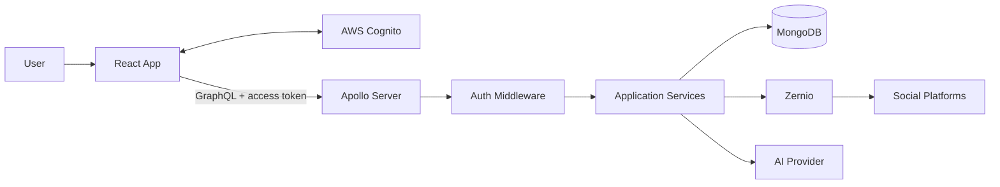
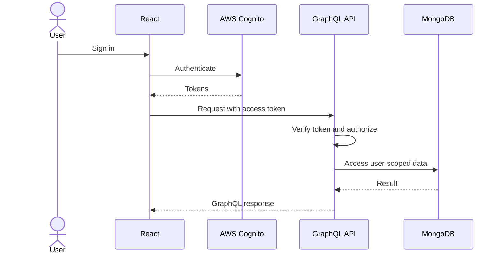
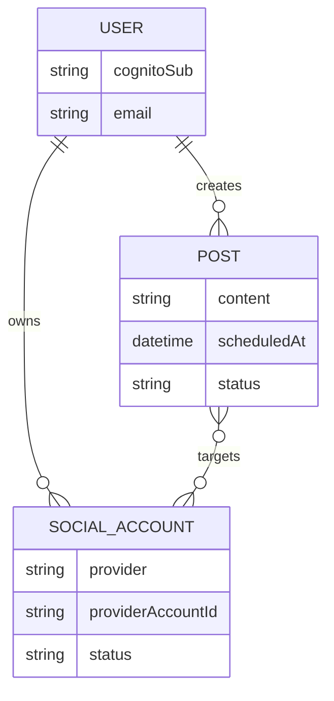

<div align="center">

# Social Media Management Platform

**Create, organize, and schedule social content from one workspace.**


Built with React, TypeScript, Tailwind CSS, Node.js, GraphQL, MongoDB, AWS Cognito, and Zernio.

</div>

---

## ✨ Overview

A centralized workspace for managing connected social accounts, drafting content with AI assistance, previewing posts, and planning publishing schedules.

## 🚀 Features

- **Authentication** — Sign up, email verification, login, and protected routes.
- **Social accounts** — Connect supported platforms through Zernio.
- **Content composer** — Draft, edit, and preview posts.
- **AI-assisted writing** — Generate or improve post copy.
- **Scheduling calendar** — Plan posts and track publishing status.

## 🧰 Tech Stack

| Frontend | Backend & Services |
|---|---|
| React + TypeScript | Node.js |
| Tailwind CSS, Zod | Apollo Server + GraphQL |
| AWS Cognito | MongoDB |
|  | Zernio integration |

## 🏗️ Architecture



## 🧩 Low-Level Design

| Module | Responsibility |
|---|---|
| **Auth** | Verify Cognito access tokens and identify the user |
| **User** | Maintain the application user profile |
| **Social Accounts** | Manage connected-account metadata |
| **Posts** | Create, edit, and validate drafts |
| **Scheduling** | Validate schedule times and coordinate publishing |
| **Integrations** | Encapsulate Zernio and AI-provider API calls |

### Authentication flow



### Data model



**Key design rules**
- Derive identity from the verified token, not a client-supplied user ID.
- Check resource ownership on every protected operation.
- Keep provider-specific logic inside integration modules.
- Store schedule times in UTC.
- Use durable or provider-managed scheduling rather than in-memory timers.

## 🔐 Security

- Verify Cognito JWT signature, issuer, expiry, and token type.
- Keep API keys on the backend; never commit secrets.
- Validate input on both client and server.
- Never expose provider credentials in API responses or logs.
- Enforce ownership checks for database operations.

## ⚙️ Setup

1. Clone the repository and install dependencies in the frontend/backend folders.
2. Configure local environment variables.
3. Set up Cognito, MongoDB, Zernio, and the AI provider if enabled.
4. Start each app using the scripts defined in its `package.json`.

Example commands (if these scripts exist):

```bash
npm install
npm run dev
```

## 🔑 Environment Variables

Example names only; match them to your code.

```dotenv
# Frontend
VITE_API_URL=http://localhost:4000/graphql
VITE_COGNITO_USER_POOL_ID=your_user_pool_id
VITE_COGNITO_CLIENT_ID=your_app_client_id

# Backend
PORT=4000
MONGODB_URI=mongodb://127.0.0.1:27017/social_media_platform
AWS_REGION=your_aws_region
COGNITO_USER_POOL_ID=your_user_pool_id
ZERNIO_API_KEY=your_secret
AI_API_KEY=your_secret
```

> Never put backend secrets in `VITE_` variables; Vite exposes them to the browser.

---

<div align="center">

**Simplifying multi-platform content planning.**

</div>
